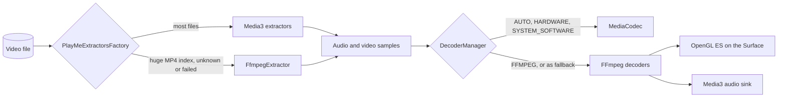

<div align="center">

# PlayMedia

**FFmpeg decoding, container reading, media info and thumbnails for Android Media3 (ExoPlayer)**

[](CHANGELOG.md)
[](LICENSE)
[](https://github.com/androidx/media)
[](https://ffmpeg.org)
[](https://developer.android.com/about/versions/marshmallow)
[](https://developer.android.com/guide/practices/page-sizes)

Plays what the device can't, opens what Media3 can't, and describes any file.

[Features](#features) · [Installation](#installation) · [Quick start](#quick-start) · [Guides](#guides) · [How it works](#how-it-works) · [Testing](#testing) · [Licence](#licence)

</div>

---

## Features

|  | What you get |
|---|---|
| 🎬 **Video decoding** | H.264, HEVC (8 and 10-bit), VP8, VP9, AV1 (dav1d), MPEG-1/2, MPEG-4 Part 2, H.263, VC-1, MJPEG, drawn with OpenGL ES in the frame's own colours |
| 🔊 **Audio decoding** | AC-3, E-AC-3 (JOC), DTS, DTS-HD (core), TrueHD, FLAC, Opus, Vorbis, ALAC, AAC, MP1/2/3, AMR-NB/WB, G.711, up to 8 channels |
| 🔀 **Live decoder switching** | `AUTO`, `HARDWARE`, `SYSTEM_SOFTWARE`, `FFMPEG`, changed while playing without rebuilding the player or its media session |
| 📦 **Container fallback** | FFmpeg reads what Media3 can't: MP4s with huge indexes (a 27-hour recording), unknown or broken containers |
| 🔎 **Media info** | Streams, codecs, resolution, frame rate, HDR type and bit depth, rotation, languages, chapters, attachments, cover art |
| 🖼️ **Thumbnails** | Key frame or exact frame, upright, fitted to a size; cover art for audio |
| ⏱️ **Subtitle timing** | Delay and speed correction for out-of-sync subtitles |

**Compatibility:** min SDK 23 · Media3 1.11.1 · `arm64-v8a`, `armeabi-v7a`, `x86_64`, `x86` · 16 KB page aligned (Android 15+)

## Installation

```kotlin
// settings.gradle.kts
dependencyResolutionManagement {
    repositories {
        google()
        mavenCentral()
        maven { url = uri("https://jitpack.io") }
    }
}
```

```kotlin
// build.gradle.kts
dependencies {
    implementation("com.github.baboDev123.play_media_library:media-decoder:v2.1.0")   // renderers, decoder switching
    implementation("com.github.baboDev123.play_media_library:media-extractor:v2.1.0") // container fallback
    implementation("com.github.baboDev123.play_media_library:media-info:v2.1.0")      // media info, thumbnails
}
```

Each module brings `media-core`, the native engine, with it. Take only the ones you need.

| Module | Contents |
|---|---|
| `media-core` | `libplaymedia.so`: FFmpeg and dav1d, statically linked; `PlayMediaNative` |
| `media-decoder` | `PlayMeRenderersFactory`, `DecoderManager`, `DecoderMode`, `SubtitleTiming`, `PlayMeVideoRenderer`, `PlayMeAudioRenderer`, `DecoderController` |
| `media-extractor` | `PlayMeExtractorsFactory`, `FfmpegExtractor`, `FfmpegFallback` |
| `media-info` | `MediaInfoExtractor`, `ThumbnailExtractor` |

## Quick start

```kotlin
val decoders = DecoderManager()
val player = ExoPlayer.Builder(context)
    .setRenderersFactory(PlayMeRenderersFactory(context, decoderManager = decoders))
    .setMediaSourceFactory(DefaultMediaSourceFactory(context, PlayMeExtractorsFactory(context)))
    .build()
decoders.attach(player)

player.setMediaItem(MediaItem.fromUri(videoUri))
player.prepare()
player.play()
```

That's all a player needs: the device's decoders play what they can and FFmpeg the rest, and
Media3 opens what it can and FFmpeg the rest.

## Guides

### Decoder modes

| `DecoderMode` | Video | Audio |
|---|---|---|
| `AUTO` *(default)* | Device decoders; FFmpeg for what they can't play | Device decoders; FFmpeg for the rest |
| `HARDWARE` | Hardware decoders only | Device decoders |
| `SYSTEM_SOFTWARE` | Android's software decoders only | Android's software decoders only |
| `FFMPEG` | FFmpeg; the device only for formats FFmpeg lacks | FFmpeg; the device for the rest |

Android's audio decoders are software, so `HARDWARE` audio means the device's decoders.

### Switching decoders while playing

```kotlin
decoders.selectVideoDecoder(DecoderMode.FFMPEG)
decoders.selectAudioDecoder(DecoderMode.AUTO)

decoders.activeVideoMode // FFMPEG once FFmpeg took over; AUTO while the device's decoders play
```

The player, its playlist and its media session stay; Media3 moves the track to the new decoder
at the current position. `attach` needs ExoPlayer's default `DefaultTrackSelector`. With no
decoder of the chosen kind (say `HARDWARE` for a format the hardware can't decode) the track
stays unplayed and the app decides what to fall back to.

For apps without a media session, `DecoderController` rebuilds the player for each change and
carries over position, play/pause, speed and track selection.

### Opening files Media3 can't

`PlayMeExtractorsFactory` keeps Media3's extractors in charge and adds FFmpeg for local files
(file and content URIs):

| When | FFmpeg reads the file |
|---|---|
| No Media3 extractor recognises the container | after Media3's extractors |
| An MP4 index (`moov`) is over 40 MB | before them: Media3 keeps it in the Java heap and runs out of memory |
| The app marked the file after a failure | before them |

```kotlin
override fun onPlayerError(error: PlaybackException) {
    val uri = player.currentMediaItem?.localConfiguration?.uri ?: return
    val containerFailed = error.errorCode == PlaybackException.ERROR_CODE_PARSING_CONTAINER_MALFORMED ||
        error.errorCode == PlaybackException.ERROR_CODE_PARSING_CONTAINER_UNSUPPORTED ||
        generateSequence(error.cause) { it.cause }.any { it is OutOfMemoryError }
    if (containerFailed && !FfmpegFallback.isPreferred(uri)) {
        FfmpegFallback.prefer(uri)
        player.prepare() // carries on from where it was, read by FFmpeg
    }
}
```

FFmpeg only reads the container; decoding still goes through the renderers, so these files
play like any other. Their formats have ids `playmedia/<stream>`. Subtitle streams inside
files read by FFmpeg aren't passed on yet.

> **Measured:** a 27-hour MP4 with a 114 MB index failed in Media3 with `OutOfMemoryError` on a
> 256 MB heap. Through FFmpeg it plays within a 192 MB heap, using 5–16 MB of it, with the full
> 27:02 duration and seeking anywhere.

### Subtitle timing

```kotlin
val timing = SubtitleTiming()
val renderers = PlayMeRenderersFactory(context, subtitleTiming = timing)

timing.delayMs = 500   // subtitles half a second later
timing.speed = 1.042f  // subtitles made for 25 fps, on a 23.976 fps video
```

Changes apply on the next frame. Give every factory the same `SubtitleTiming` and the setting
survives a player rebuild.

### Media info

```kotlin
val info = MediaInfoExtractor.extract(context, uri) // suspend; also paths and descriptors

info.durationMs
info.primaryVideo?.hdrType                          // NONE, HDR10, HLG, DOLBY_VISION
info.primaryVideo?.bitDepth
info.audioStreams.map { it.language to it.channelLayout }
info.chapters
info.embeddedFonts                                  // Matroska fonts for ASS subtitles
```

Network files go through an `android.media.MediaDataSource`. It reads with random access, so
MP4s with their index at the end work too:

```kotlin
val info = MediaInfoExtractor.extract(object : MediaDataSource() {
    override fun getSize() = remoteFile.length
    override fun readAt(position: Long, buffer: ByteArray, offset: Int, size: Int) =
        remoteFile.read(position, buffer, offset, size)
    override fun close() = Unit
})
```

Every read gives up after `timeoutMs` (15 s by default); failures throw `PlayMediaException`.

### Thumbnails

```kotlin
val bitmap = ThumbnailExtractor.getFrameAt(context, uri, timeUs = 5_000_000, targetWidth = 320, targetHeight = 180)
```

The default is the key frame at or before the time, which is quick; `exact = true` decodes on
to the frame at that time. Frames come upright and fitted inside the size; audio files give
their cover picture.

### From Java

The blocking (`extractSync`, `getFrameAtSync`) and callback (`extractAsync`, `getFrameAtAsync`)
functions are `@JvmStatic` with `@JvmOverloads`; renderers and factories are ordinary classes.

## How it works



- **One native library.** `libplaymedia.so` holds FFmpeg 7.1.1 and dav1d 1.5.1, built by
  `ffmpeg/build.sh` with only the decoders, parsers and demuxers used, no GPL code, and 16 KB
  page alignment.
- **Every frame.** The video decoder runs FFmpeg on its own thread and hands over frames as
  they finish, so multithreaded decoding and B-frames lose none, the last ones included.
- **Timed by Media3.** Media3 decides when each frame shows and drops late ones; frames are
  drawn with OpenGL ES, the GPU turning YUV into RGB.
- **Memory.** Large indexes stay in native memory; repeated playback, seeking and probing keep
  native memory flat (tested).

## Testing

| Command | Covers |
|---|---|
| `./gradlew :media-decoder:testDebugUnitTest` | Subtitle timing |
| `./gradlew :media-extractor:testDebugUnitTest` | MP4 index sizing |
| `./gradlew :media-tests:connectedDebugAndroidTest` | 62 device tests on AndroidX Media's sample media |

The device tests hold FFmpeg to Media3 and the device's own decoders:

- **Decoding:** as many video frames as the device decoder and the full length of audio, for every codec above;
- **Picture:** what FFmpeg draws on screen looks like the device decoder's picture;
- **Containers:** FFmpeg reads MP4, Matroska, WebM, MPEG-TS, AVI, FLV, 3GP, AMR and FLAC to the same frames and audio as Media3, while files Media3 reads stay with Media3;
- **Switching:** decoders change while playing, video and audio;
- **Info:** media info from every kind of input, thumbnails, timeouts, and steady native memory.

## Building from source

```sh
./ffmpeg/build.sh          # once: downloads FFmpeg and dav1d, builds them for every ABI (~15 min)
./gradlew assembleRelease
```

Needs JDK 17, the Android NDK 28.2 and Python 3. The build stops if FFmpeg ever ends up
configured as GPL or nonfree.

## Versioning

PlayMedia follows [Semantic Versioning](https://semver.org). The version lives in
`gradle.properties` (`VERSION_NAME`) and at run time in `PlayMediaNative.version`; releases are
tagged `vX.Y.Z`. See [CHANGELOG.md](CHANGELOG.md) for what changed in each.

## Licence

PlayMedia's own code is licensed under the [Apache License 2.0](LICENSE).

It includes [FFmpeg](https://ffmpeg.org) under the **LGPL 2.1 or later** and
[dav1d](https://code.videolan.org/videolan/dav1d) under the **BSD 2-Clause** licence. An app
that ships PlayMedia must credit FFmpeg, include the LGPL text and offer FFmpeg's source: see
[NOTICE](NOTICE).
