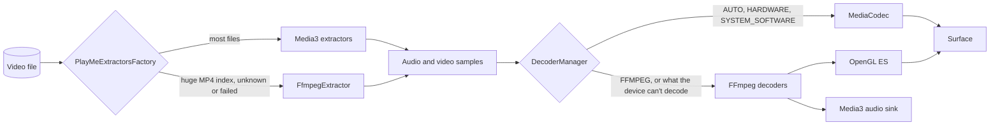

<div align="center">

# PlayMedia

### The playback engine for Android players that have to open everything.

FFmpeg decoding, container reading, media info and thumbnails for **Media3 (ExoPlayer)**:
hardware first, FFmpeg wherever the device gives up.

[](CHANGELOG.md)
[](LICENSE)
[](https://github.com/androidx/media)
[](https://ffmpeg.org)
[](https://code.videolan.org/videolan/dav1d)
[](https://developer.android.com/about/versions/marshmallow)
[](https://developer.android.com/guide/practices/page-sizes)
[](#testing)

[Why PlayMedia](#why-playmedia) ·
[Features](#features) ·
[Installation](#installation) ·
[Quick start](#quick-start) ·
[Guides](#guides) ·
[Architecture](#architecture) ·
[Performance](#performance) ·
[Testing](#testing) ·
[FAQ](#faq) ·
[Licence](#licence)

</div>

---

## Why PlayMedia

Media3 plays what the phone's decoders and its own extractors understand. A real video
library holds more than that: AC-3 and DTS soundtracks on phones without the licence, 10-bit
HEVC on older chips, AVI and FLV files, MP4s with indexes too big for the Java heap. PlayMedia
closes those gaps without taking anything away from Media3:

- **Hardware first.** The device's decoders keep every format they can play, 4K at 60 fps and
  8K included, so playback stays smooth and light on the battery.
- **FFmpeg for the rest.** Formats the device can't decode, and containers Media3 can't read,
  go to FFmpeg automatically.
- **One player, live switching.** Decoders change while playing, without rebuilding the player
  or its media session.
- **Small and clean.** One native library with only the decoders, parsers and demuxers used;
  LGPL FFmpeg with no GPL or nonfree code; 16 KB page aligned for Android 15+.

## Features

|  | What you get |
|---|---|
| 🎬 **Video decoding** | H.264, HEVC (8 and 10-bit), VP8, VP9, AV1 (dav1d), MPEG-1/2, MPEG-4 Part 2, H.263, VC-1, MJPEG, drawn with OpenGL ES in the frame's own colours |
| 🔊 **Audio decoding** | AC-3, E-AC-3 (JOC), DTS, DTS-HD (core), TrueHD, FLAC, Opus, Vorbis, ALAC, AAC, MP1/2/3, AMR-NB/WB, G.711, up to 8 channels |
| ⚡ **High resolution** | 4K60 and 8K stay on the hardware decoder in `AUTO`, even past the size and frame rate the decoder claims |
| 🔀 **Live decoder switching** | `AUTO`, `HARDWARE`, `SYSTEM_SOFTWARE`, `FFMPEG`, changed while playing |
| 📦 **Container fallback** | FFmpeg reads what Media3 can't: MP4s with huge indexes (a 27-hour recording), unknown or broken containers |
| 🔎 **Media info** | Streams, codecs, resolution, frame rate, HDR type and bit depth, rotation, languages, chapters, attachments, cover art |
| 🖼️ **Thumbnails** | Key frame or exact frame, upright, fitted to a size; cover art for audio |
| ⏱️ **Subtitle timing** | Delay and speed correction for out-of-sync subtitles |

### Requirements

| | |
|---|---|
| Android | API 23 (6.0) and newer |
| Media3 | 1.11.1 |
| ABIs | `arm64-v8a`, `armeabi-v7a`, `x86_64`, `x86` |
| Page size | 4 KB and 16 KB (Android 15+) |
| Languages | Kotlin and Java |

## Installation

```kotlin
// settings.gradle.kts
dependencyResolutionManagement {
    repositories {
        google()
        mavenCentral()
        maven { url = uri("https://jitpack.io") }
    }
}
```

```kotlin
// build.gradle.kts
dependencies {
    implementation("com.github.baboDev123.play_media_library:media-decoder:v2.1.1")   // renderers, decoder switching
    implementation("com.github.baboDev123.play_media_library:media-extractor:v2.1.1") // container fallback
    implementation("com.github.baboDev123.play_media_library:media-info:v2.1.1")      // media info, thumbnails
}
```

Each module brings `media-core`, the native engine, with it. Take only the ones you need.

| Module | What it contains |
|---|---|
| `media-core` | `libplaymedia.so` (FFmpeg and dav1d, statically linked) and `PlayMediaNative` |
| `media-decoder` | `PlayMeRenderersFactory`, `DecoderManager`, `DecoderMode`, `SubtitleTiming`, `PlayMeVideoRenderer`, `PlayMeAudioRenderer`, `DecoderController` |
| `media-extractor` | `PlayMeExtractorsFactory`, `FfmpegExtractor`, `FfmpegFallback` |
| `media-info` | `MediaInfoExtractor`, `ThumbnailExtractor` |

<details>
<summary><b>Building against a local checkout</b></summary>

Run `./ffmpeg/build.sh` in the checkout once, then point the app at it:

```kotlin
// settings.gradle.kts of the app
includeBuild("../playme-media") {
    dependencySubstitution {
        substitute(module("io.github.playme:media-decoder")).using(project(":media-decoder"))
        substitute(module("io.github.playme:media-extractor")).using(project(":media-extractor"))
        substitute(module("io.github.playme:media-info")).using(project(":media-info"))
    }
}
```

</details>

## Quick start

```kotlin
val decoders = DecoderManager()
val player = ExoPlayer.Builder(context)
    .setRenderersFactory(PlayMeRenderersFactory(context, decoderManager = decoders))
    .setMediaSourceFactory(DefaultMediaSourceFactory(context, PlayMeExtractorsFactory(context)))
    .build()
decoders.attach(player)

player.setMediaItem(MediaItem.fromUri(videoUri))
player.prepare()
player.play()
```

That is all a player needs. The device's decoders play what they can and FFmpeg the rest;
Media3 opens what it can and FFmpeg the rest.

## Guides

### Decoder modes

| `DecoderMode` | Video | Audio |
|---|---|---|
| `AUTO` *(default)* | Device decoders; FFmpeg only for codecs or profiles no hardware decoder handles | Device decoders; FFmpeg for the rest |
| `HARDWARE` | Hardware decoders only | Device decoders |
| `SYSTEM_SOFTWARE` | Android's software decoders only | Android's software decoders only |
| `FFMPEG` | FFmpeg; the device only for formats FFmpeg lacks | FFmpeg; the device for the rest |

Android's audio decoders are software, so `HARDWARE` audio means the device's decoders.

> [!NOTE]
> **Why `AUTO` keeps heavy video on the hardware.** Many decoders list a lower limit than they
> actually reach, say 4K at 30 fps, and Media3 then marks a 4K60 or 8K stream as beyond them.
> A phone CPU can't decode such a stream in software in real time, so `AUTO` only looks at the
> codec and profile. If the hardware decoder fails to start after all, Media3 tries the
> device's next decoder, and the app can switch to `FFMPEG` from its error handler.

### Switching decoders while playing

```kotlin
decoders.selectVideoDecoder(DecoderMode.FFMPEG)
decoders.selectAudioDecoder(DecoderMode.AUTO)

decoders.activeVideoMode // FFMPEG once FFmpeg took over; AUTO while the device's decoders play
```

The player, its playlist and its media session stay; Media3 moves the track to the new decoder
at the current position. `attach` needs ExoPlayer's default `DefaultTrackSelector`. With no
decoder of the chosen kind (say `HARDWARE` for a format the hardware can't decode) the track
stays unplayed and the app decides what to fall back to.

For apps without a media session, `DecoderController` rebuilds the player for each change and
carries over position, play/pause, speed and track selection.

### Opening files Media3 can't

`PlayMeExtractorsFactory` keeps Media3's extractors in charge and adds FFmpeg for local files
(file and content URIs):

| When | FFmpeg reads the file |
|---|---|
| No Media3 extractor recognises the container | after Media3's extractors |
| An MP4 index (`moov`) is over 40 MB | before them: Media3 keeps it in the Java heap and runs out of memory |
| The app marked the file after a failure | before them |

```kotlin
override fun onPlayerError(error: PlaybackException) {
    val uri = player.currentMediaItem?.localConfiguration?.uri ?: return
    val containerFailed = error.errorCode == PlaybackException.ERROR_CODE_PARSING_CONTAINER_MALFORMED ||
        error.errorCode == PlaybackException.ERROR_CODE_PARSING_CONTAINER_UNSUPPORTED ||
        generateSequence(error.cause) { it.cause }.any { it is OutOfMemoryError }
    if (containerFailed && !FfmpegFallback.isPreferred(uri)) {
        FfmpegFallback.prefer(uri)
        player.prepare() // carries on from where it was, read by FFmpeg
    }
}
```

FFmpeg only reads the container; decoding still goes through the renderers, so these files
play like any other. Their formats have ids `playmedia/<stream>`. Subtitle streams inside
files read by FFmpeg aren't passed on yet.

### Subtitle timing

```kotlin
val timing = SubtitleTiming()
val renderers = PlayMeRenderersFactory(context, subtitleTiming = timing)

timing.delayMs = 500   // subtitles half a second later
timing.speed = 1.042f  // subtitles made for 25 fps, on a 23.976 fps video
```

Changes apply on the next frame. Give every factory the same `SubtitleTiming` and the setting
survives a player rebuild.

### Media info

```kotlin
val info = MediaInfoExtractor.extract(context, uri) // suspend; also paths and descriptors

info.durationMs
info.primaryVideo?.hdrType                          // NONE, HDR10, HLG, DOLBY_VISION
info.primaryVideo?.bitDepth
info.audioStreams.map { it.language to it.channelLayout }
info.chapters
info.embeddedFonts                                  // Matroska fonts for ASS subtitles
```

Network files go through an `android.media.MediaDataSource`. It reads with random access, so
MP4s with their index at the end work too:

```kotlin
val info = MediaInfoExtractor.extract(object : MediaDataSource() {
    override fun getSize() = remoteFile.length
    override fun readAt(position: Long, buffer: ByteArray, offset: Int, size: Int) =
        remoteFile.read(position, buffer, offset, size)
    override fun close() = Unit
})
```

Every read gives up after `timeoutMs` (15 s by default); failures throw `PlayMediaException`.

### Thumbnails

```kotlin
val bitmap = ThumbnailExtractor.getFrameAt(context, uri, timeUs = 5_000_000, targetWidth = 320, targetHeight = 180)
```

The default is the key frame at or before the time, which is quick; `exact = true` decodes on
to the frame at that time. Frames come upright and fitted inside the size; audio files give
their cover picture.

### From Java

The blocking (`extractSync`, `getFrameAtSync`) and callback (`extractAsync`, `getFrameAtAsync`)
functions are `@JvmStatic` with `@JvmOverloads`; renderers and factories are ordinary classes.

## Architecture



- **One native library.** `libplaymedia.so` holds FFmpeg 7.1.1 and dav1d 1.5.1, built by
  `ffmpeg/build.sh` with only the decoders, parsers and demuxers used, no GPL code, and 16 KB
  page alignment.
- **Gated renderers.** `PlayMeRenderersFactory` builds a renderer for each kind of decoder;
  `DecoderManager` decides which of them may take a format and tells Media3 when that changes.
- **Every frame.** The FFmpeg video decoder runs on its own thread with frame and slice
  threading (one thread per core, up to 8) and hands over frames as they finish, so
  multithreaded decoding and B-frames lose none, the last ones included.
- **Timed by Media3.** Media3 decides when each frame shows and drops late ones; FFmpeg frames
  are drawn with OpenGL ES, the GPU turning YUV into RGB with the frame's own colour matrix.
- **Memory.** Large indexes stay in native memory; repeated playback, seeking and probing keep
  native memory flat (tested).

## Performance

| Case | Result |
|---|---|
| 4K60 and 8K video in `AUTO` | Played by the hardware decoder whenever the device has one for the codec and profile |
| 27-hour MP4 with a 114 MB index | Media3 alone: `OutOfMemoryError` on a 256 MB heap. With PlayMedia: plays within a 192 MB heap using 5–16 MB of it, full 27:02 duration, seeking anywhere |
| Repeated playback, seeking, probing | Native memory stays flat (device tests) |

## Testing

| Command | Covers |
|---|---|
| `./gradlew :media-decoder:testDebugUnitTest` | Decoder mode rules, subtitle timing |
| `./gradlew :media-extractor:testDebugUnitTest` | MP4 index sizing |
| `./gradlew :media-tests:connectedDebugAndroidTest` | 62 device tests on AndroidX Media's sample media |

The device tests hold FFmpeg to Media3 and the device's own decoders:

- **Decoding:** as many video frames as the device decoder and the full length of audio, for every codec above;
- **Picture:** what FFmpeg draws on screen looks like the device decoder's picture;
- **Containers:** FFmpeg reads MP4, Matroska, WebM, MPEG-TS, AVI, FLV, 3GP, AMR and FLAC to the same frames and audio as Media3, while files Media3 reads stay with Media3;
- **Switching:** decoders change while playing, video and audio;
- **Info:** media info from every kind of input, thumbnails, timeouts, and steady native memory.

## Building from source

```sh
./ffmpeg/build.sh          # once: downloads FFmpeg and dav1d, builds them for every ABI (~15 min)
./gradlew assembleRelease
```

Needs JDK 17, the Android NDK 28.2 and Python 3. The build stops if FFmpeg ever ends up
configured as GPL or nonfree.

```text
playme-media/
├── ffmpeg/            FFmpeg and dav1d build script (outputs are git-ignored)
├── media-core/        libplaymedia.so: JNI over FFmpeg (decoders, demuxer, probe, OpenGL ES drawing)
├── media-decoder/     Media3 renderers, DecoderManager, subtitle timing
├── media-extractor/   FFmpeg container reading for Media3
├── media-info/        Media info and thumbnails
└── media-tests/       Device tests against real media
```

## FAQ

<details>
<summary><b>A 4K or 8K video stutters. What should I check?</b></summary>

Make sure the video decoder mode is `AUTO` or `HARDWARE`: `FFMPEG` decodes on the CPU, which
no phone does fast enough at those sizes. If it still stutters on the hardware, the device's
chip can't decode that stream in real time. `decoders.activeVideoMode` and Media3's
`AnalyticsListener.onVideoDecoderInitialized` tell you which decoder is playing.

</details>

<details>
<summary><b>Does PlayMedia make my app GPL?</b></summary>

No. FFmpeg is built without GPL or nonfree parts and is licensed under the LGPL 2.1 or later.
Your app must credit FFmpeg, include the LGPL text and offer FFmpeg's source: see
[NOTICE](NOTICE).

</details>

<details>
<summary><b>Can FFmpeg play DRM-protected streams?</b></summary>

No. Encrypted formats stay with the device's decoders.

</details>

<details>
<summary><b>How much does it add to the APK?</b></summary>

One native library per ABI. Ship an App Bundle, or split the APK by ABI, so each device gets
only its own.

</details>

## Versioning

PlayMedia follows [Semantic Versioning](https://semver.org). The version lives in
`gradle.properties` (`VERSION_NAME`) and at run time in `PlayMediaNative.version`; releases are
tagged `vX.Y.Z`. See [CHANGELOG.md](CHANGELOG.md) for what changed in each.

## Licence

PlayMedia's own code is licensed under the [Apache License 2.0](LICENSE).

It includes [FFmpeg](https://ffmpeg.org) under the **LGPL 2.1 or later** and
[dav1d](https://code.videolan.org/videolan/dav1d) under the **BSD 2-Clause** licence. An app
that ships PlayMedia must credit FFmpeg, include the LGPL text and offer FFmpeg's source: see
[NOTICE](NOTICE).
